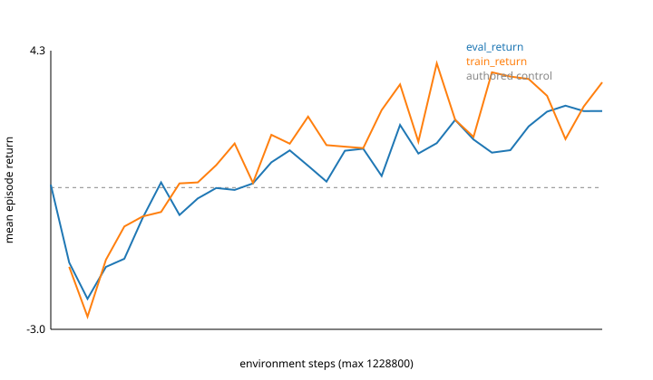

# PPO on the bundled Richmond Field Station task set

PPO from `simforge_rl.examples.ppo`, trained for 1,228,800 environment steps (10,832 episodes, 38 minutes at the lowest CPU priority on a 24-core CPU host with no GPU) on the bundled `richmond-field-station` task set: 24 tasks from 15 scenario templates, each at a verified site of Richmond Field Station v9 as its distribution map pack has it. Episodes ran in the distributable runtime (`simforge-runtime 0.1.0+c9e184cc1b0b6292`, engine 0.31.0, installed with `simforge runtime install`), one `simforge-runtime serve` per vector worker, and the package was the reproducibly built `simforge_rl-0.1.1` wheel.

| | Initial policy | After training | Authored ego control |
|---|---|---|---|
| Mean evaluation return (24 tasks x 2 held-out seeds) | 0.79 | **2.74** | 0.71 |
| Mean training return (last 128 episodes) | -1.39 at 41k steps | 3.50 | |



The trained policy beats the scenarios' own authored driving on 12 of the 24 tasks and on average. It learned to cross behind cyclists and to pass well (cyclist-crossing-path@16d03889 20.3 against -8.2, oncoming-overtake@ddc37703 15.4 against 5.3, the unprotected left turn 11.0 against 2.9) and still crashes where the authored driving does not: both disabled-vehicle tasks, one lead-hard-brake and one parked-row task (about -7 to -8).

| Task | Authored control | Initial policy | After training |
|---|---|---|---|
| adult-midblock-crossing@158aa402 | 4.94 | -7.38 | 8.46 |
| adult-midblock-crossing@27d53507 | 3.20 | 8.80 | 0.67 |
| backing-out-vehicle@02931707 | -0.00 | 5.33 | 5.54 |
| backing-out-vehicle@2622e37c | -0.25 | -9.56 | -0.24 |
| cpnco-parked-row@c7794a7c | 2.38 | -7.15 | 0.22 |
| cpnco-parked-row@de9c337a | 2.40 | -7.06 | -7.08 |
| cyclist-crossing-path@0e7787e6 | -8.60 | 7.27 | 5.24 |
| cyclist-crossing-path@16d03889 | -8.17 | 8.43 | 20.25 |
| disabled-vehicle@69939930 | 0.55 | -8.18 | -8.18 |
| disabled-vehicle@894df17b | 1.22 | -8.26 | -8.28 |
| lead-hard-brake@1e29b9bd | 1.88 | -7.58 | -7.73 |
| lead-hard-brake@391af02d | 1.88 | -7.58 | 1.00 |
| light-corridor@1c0e6bed | 1.99 | 7.63 | 9.49 |
| ltap-opposing@9fc1b2c2 | 2.89 | 9.57 | 10.95 |
| oncoming-overtake@b1ed39e5 | -8.92 | 10.23 | -8.54 |
| oncoming-overtake@ddc37703 | 5.31 | 11.27 | 15.41 |
| opposing-turn-encroachment@23afb358 | 1.20 | 6.55 | 9.68 |
| queue-tail@1ae48fb3 | 1.55 | -7.62 | 0.20 |
| queue-tail@e2e894a1 | 1.55 | -7.62 | 0.35 |
| red-light-late-entry@027da72d | 5.02 | 5.02 | 4.84 |
| right-turn-crosswalk@109e9d91 | 1.26 | 6.69 | 5.05 |
| urban-mixed@42144495 | -0.89 | -8.44 | -0.98 |
| vehicle-pulls-out@6fcaaefa | 2.38 | 9.80 | 0.15 |
| vehicle-pulls-out@85b4ac66 | 2.29 | 8.78 | 9.29 |

Evaluation uses the policy's mean action, so a single crash moves a task to about -7 to -10.

- `curve.csv`: evaluation return (mean and per task) and training return against environment steps, every 10 updates.
- `metadata.json`: configuration, the map pin, every task's template digest and site, runtime and package versions.
- `reproducibility.json`: runtime release, archive and binary digests, wheel digest, map, policy and curve digests, and the same-seed repeat.

Reproduce, after `simforge runtime install` and `simforge maps pull richmond-field-station@v9`:

```sh
pip install 'simforge-rl[ppo]==0.1.1'
python -m simforge_rl.examples.ppo --tasks richmond-field-station --runtime --num-envs 32 \
  --total-timesteps 1228800 --eval-every 10 --seed 0 --out run --json
```
